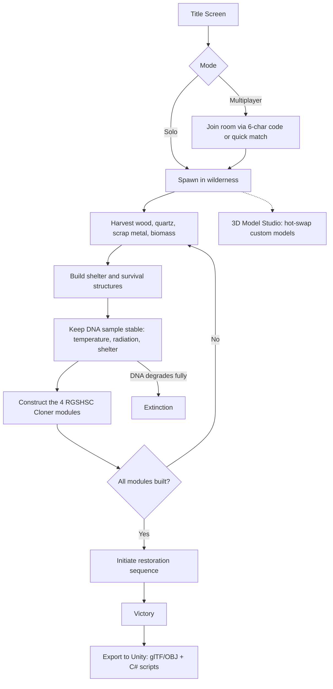
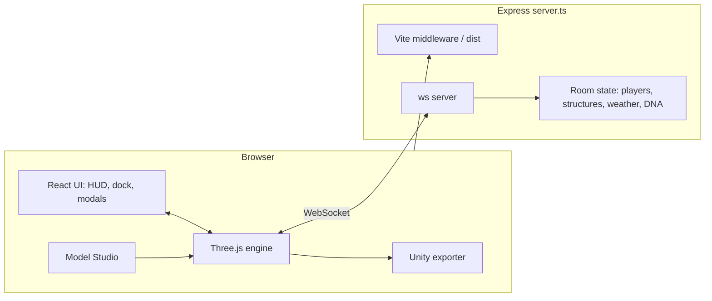
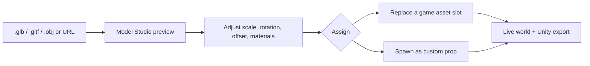

<h1 align="center">🧬 RGSHSC: The Last Strand</h1>

<p align="center"><em>Protect humanity's final DNA sample. Survive. Build. Rebuild the species.</em></p>

<p align="center">Author: <strong>Rudransh Pradhan</strong></p>

A first-person 3D multiplayer survival game that runs in the browser. You safeguard humanity's final DNA sample, scavenge resources, build shelter, and construct the **Reproductive Gene Shifting Homo Sapien Cloner (RGSHSC)**. You can also export the game's assets and C# scripts to Unity.

## Features

- **First-person survival**: pointer-lock look, sprint, jump, harvesting, crafting, and a day/night cycle with dynamic weather.
- **Base building**: place foundations, walls, roofs, solar panels, water condensers, campfires, cryo stasis pods, and nutrient bioreactors.
- **The Cloner**: build the four sequential modules of the RGSHSC while keeping the DNA sample alive through temperature, radiation, and shelter threats.
- **Multiplayer**: room-based co-op over WebSockets. Join with a 6-character room code or use quick matchmaking. Players share movement, structures, resources, weather, and chat.
- **Procedural visuals**: models, terrain, and effects are generated in code with Three.js.
- **Custom 3D assets for everything**: replace the procedural model of any game asset (structures, resources, the Cloner, and player avatar/tool) with your own. See [Custom 3D Assets](#custom-3d-assets).
- **Unity exporter**: download glTF/OBJ models and a C# script package (`RGSHSC_Cloner.cs`, `SurvivorController.cs`, `DNAStasisPod.cs`) for Unity 2021 LTS, 2022 LTS, and Unity 6.

## Gameplay Flow



## Architecture



## Tech Stack

React 19, TypeScript, Vite, Tailwind CSS 4, Three.js, Express, `ws` (WebSockets), Motion, and `@google/genai`.

## Getting Started

**Prerequisites:** Node.js 20+ (or [Bun](https://bun.sh), since the repo includes `bun.lock`).

```bash
# 1. Install dependencies
npm install        # or: bun install

# 2. Configure environment
cp .env.example .env
# then set GEMINI_API_KEY in .env

# 3. Start the dev server (Express + Vite + WebSocket)
npm run dev
```

Open <http://localhost:3000>. To play with others on the same network, share the LAN URL the server reports (the server runs on `PORT`, default `3000`).

## Environment Variables

| Variable | Description |
| --- | --- |
| `GEMINI_API_KEY` | Gemini API key for server-side Gemini calls. |
| `APP_URL` | URL where the app is hosted. Injected automatically by AI Studio. |
| `PORT` | Server port (default `3000`). |

## Scripts

| Command | Description |
| --- | --- |
| `npm run dev` | Start the Express/Vite dev server with WebSocket multiplayer. |
| `npm run build` | Build the client into `dist/`. |
| `npm start` | Run the server (serves `dist/` when not in development). |
| `npm run preview` | Preview the production client build. |
| `npm run lint` | Type-check with `tsc --noEmit`. |
| `npm run clean` | Remove `dist/` and `server.js`. |

## Controls

| Key | Action |
| --- | --- |
| `W` `A` `S` `D` | Move |
| `Shift` | Sprint |
| `Space` | Jump |
| `1` / `2` | Equip utility tool / tablet |
| `Q` | Cycle equipment |
| `R` | Plant seed |
| `F` | Eat food |
| `B` | Toggle build dock |
| `X` / `C` / `Esc` | Cancel build mode |
| `T` | Cycle time of day |
| `G` | Cycle weather |
| `M` | Open 3D Model Studio |
| `U` | Open Unity export |


## Custom 3D Assets

Every 3D asset in the game can be swapped for your own model through the in-game **3D Model Studio**. Open it from the bottom dock or press `M`.

**How it works**

1. Drop a `.glb`, `.gltf` (Draco-compressed meshes supported), or `.obj` file into the Studio, or load a model from a URL.
2. Inspect it on a lit turntable and adjust it:
   - **Scale:** uniform multiplier from `0.1x` to `10x`, with automatic bounding-box normalization so models of any size fit the game.
   - **Rotation:** X / Y / Z in degrees.
   - **Ground offset:** Y pivot adjustment so the model sits flush on the terrain.
   - **Materials:** tint color, metalness, roughness, emissive glow, and a wireframe view.
3. Assign it to a slot to hot-swap it into the live world, or spawn it as a custom prop. Embedded animations are preserved.

**Assignable slots**

| Category | Slots |
| --- | --- |
| Cloner | `rgshsc_core`, `gene_shifter_matrix` |
| Structures | `foundation`, `wall`, `roof`, `solar_panel`, `water_condenser`, `campfire`, `cryo_stasis_pod`, `nutrient_bioreactor` |
| Resources | `wood`, `quartzCrystal`, `scrapMetal`, `biomass` |
| Avatar | `survivor_avatar`, `fp_tool` |

Models are parsed in the browser, so nothing is uploaded to a server. Your custom bindings are also included in the Unity export. Pivot normalization keeps collisions and raycasting working with imported meshes.



## Multiplayer

The server keeps authoritative room state and handles these WebSocket messages: `join_room`, `player_move`, `build_structure`, `upgrade_cloner`, `weather_change`, `update_dna`, `resource_harvested`, and `chat`. A `POST /api/mp/sync` endpoint is also available.

## Design Docs

Implementation plans are in `.aistudio/artifacts/brain/`.

## Project Structure

```
server.ts                 Express server, Vite middleware, WebSocket multiplayer
src/
  App.tsx                 Main app, game state, hotkeys
  main.tsx                Entry point
  audio/                  Sound effects
  components/             HUD, title screen, dock, tablet, and modals
  game/
    threeEngine.ts        Three.js engine: world, player, building, weather
    proceduralAssets.ts   Procedurally generated assets
    customModelRegistry.ts  Custom model slots and transforms
    unityExporter.ts      glTF/OBJ and Unity C# export
  types/game.ts           Shared game types
```
